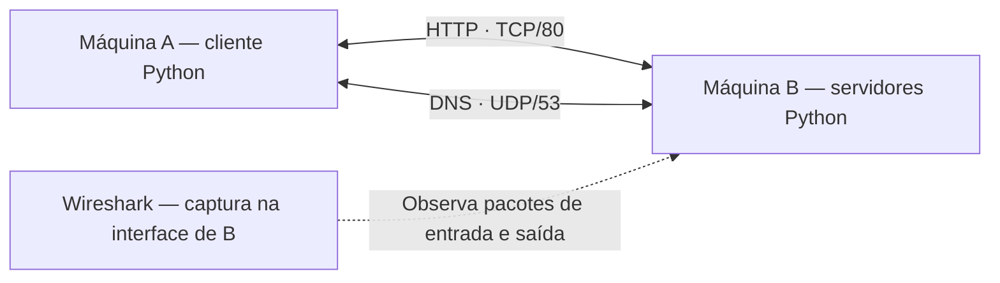

# Laboratório de Captura e Análise de Tráfego HTTP/DNS em Python

Projeto acadêmico da disciplina **Redes de Computadores**, tema **4.1 — Captura e Filtragem de Tráfego de Aplicação (HTTP/DNS)**. Linguagem principal: **Python 3.11 ou superior**.

## Objetivos

Demonstrar comunicação cliente-servidor entre duas máquinas, com requisições HTTP GET/POST e consultas DNS. A análise deverá permitir capturar pacotes ao vivo na interface correta, filtrar requisições e respostas HTTP em TCP/80 e DNS em UDP/53, identificar endereços IPv4 e portas de origem/destino e inspecionar métodos HTTP e nomes consultados.

## Arquitetura planejada

- **Máquina A:** cliente Python que gera requisições HTTP e consultas DNS diretamente a B.
- **Máquina B:** servidor HTTP em TCP/80 e servidor DNS em UDP/53. O nome didático `demo.lab.` deverá resolver para `IP_B`.
- **Wireshark:** observa o tráfego em uma interface com visibilidade da comunicação A ↔ B, preferencialmente em B. Não é um servidor de aplicação; estar na mesma rede não garante visibilidade do tráfego de outras máquinas.



Os endereços e a interface ainda serão definidos e validados nas máquinas do laboratório. Consulte a [topologia planejada](docs/topologia.md) e o [manual de preparação do ambiente — Issue #02](docs/preparacao-ambiente.md), com procedimentos Windows/Linux, diagnóstico local e matriz de validação.

## Tecnologias

| Tecnologia | Responsabilidade |
|---|---|
| Python ≥ 3.11 | Linguagem e ambiente de execução |
| Flask | Servidor HTTP GET/POST |
| requests | Futuras requisições HTTP do cliente |
| dnslib | Construção e interpretação de mensagens DNS |
| scapy | Sondagens ICMP, ARP e TCP da ferramenta auxiliar NetProbe |
| tabulate | Tabela de inventário do NetProbe |
| Wireshark | Captura e análise de pacotes; instalação separada do Python |
| Git | Versionamento e colaboração |

## Organização

Projeto-de-Redes/
│
├── src/
│   ├── __init__.py
│   ├── server_http.py
│   └── sniffer.py
│
├── tools/
│   └── netprobe.py
│
├── lab/
│   ├── client_demo.py
│   ├── server_dns.py
│   └── server_http.py
│
├── tests/
│   ├── test_server_http.py
│   └── test_integracao.py
│
├── docs/
│   ├── topologia.md
│   ├── preparacao-ambiente.md
│   └── evidencias/
│
├── requirements.txt
├── README.md
└── checklist.md

O código legado foi movido, sem alterações de conteúdo, para `tools/netprobe.py`. Ele é independente dos componentes HTTP/DNS de `src/`; suas dependências estão incluídas em `requirements.txt`. A configuração já rastreada em `.vscode/` permanece versionada; o `.gitignore` evita novos ajustes locais.

## Instalação

### Clonar

Com Git instalado e acesso ao repositório:

```sh
git clone https://github.com/FilipeCampos25/Projeto-de-Redes.git
cd Projeto-de-Redes
```

As instruções abaixo pressupõem que os arquivos desta issue já tenham sido publicados no repositório. Enquanto isso, use o checkout local preparado.

### Windows — PowerShell

Instale Python 3.11 ou superior com o launcher `py`. Na raiz do projeto:

```powershell
py -3 --version
py -3 -c "import sys; assert sys.version_info >= (3, 11), 'Python 3.11+ obrigatório'"
py -3 -m venv .venv
.\.venv\Scripts\Activate.ps1
python -m pip install -r requirements.txt
```

Se a política do PowerShell impedir a ativação, use diretamente o interpretador do ambiente, sem alterar a política do sistema:

```powershell
.\.venv\Scripts\python.exe -m pip install -r requirements.txt
.\.venv\Scripts\python.exe -m pip check
.\.venv\Scripts\python.exe -c "import flask, requests, dnslib, scapy, tabulate; print('Importações OK')"
```

### Linux — Bash

Disponibilize Python 3.11 ou superior, `pip` e o suporte a `venv` pelo gerenciador da distribuição (em algumas distribuições, `python3-venv` é separado). Na raiz do projeto:

```bash
python3 --version
python3 -c "import sys; assert sys.version_info >= (3, 11), 'Python 3.11+ obrigatório'"
python3 -m venv .venv
source .venv/bin/activate
python -m pip install -r requirements.txt
```

## Demonstração HTTP e DNS entre duas máquinas

A demonstração utiliza duas máquinas conectadas à mesma
rede local ou a uma rede virtual que permita comunicação
entre elas.

### Máquina B — Servidores

Abra dois terminais na raiz do projeto.

Terminal 1 — Servidor HTTP:

```bash
python lab/server_http.py
```

Terminal 2 — Servidor DNS:

```bash
python lab/server_dns.py
```

Informe o endereço IPv4 real da Máquina B quando solicitado.

O servidor HTTP atende em TCP/80 e o servidor DNS
em UDP/53.

### Máquina B — Wireshark

Abra o Wireshark e selecione a interface de rede
que recebe o tráfego da Máquina A.

Inicie a captura antes de executar o cliente.

### Máquina A — Cliente

Execute:

```bash
python lab/client_demo.py
```

Informe o endereço IPv4 da Máquina B.

O cliente deverá:

1. Consultar o domínio demo.lab.
2. Receber o endereço IPv4 da Máquina B.
3. Enviar uma requisição HTTP GET.
4. Enviar uma requisição HTTP POST.
5. Exibir os resultados recebidos.

### Filtros de exibição do Wireshark

HTTP:

```text
http && tcp.port == 80
```

DNS:

```text
dns && udp.port == 53
```

Comunicação entre as máquinas:

```text
ip.addr == IP_A && ip.addr == IP_B
```

Substitua IP_A e IP_B pelos endereços reais
das máquinas do laboratório.

### Confirmar a instalação

Com o ambiente ativado, em ambos os sistemas:

```sh
python --version
python -m pip check
python -c "import flask, requests, dnslib, scapy, tabulate; print('Importações OK')"
python -c "from importlib.metadata import version; print({name: version(name) for name in ('Flask', 'requests', 'dnslib', 'scapy', 'tabulate')})"
```

Use `deactivate` para sair do ambiente. A `.venv/` é local e não deve ser versionada. A instalação exige acesso ao índice de pacotes ou um cache compatível; nenhuma dependência precisa ser instalada globalmente.

As versões em `requirements.txt` ainda não estão fixadas: devem ser **congeladas após a validação funcional da aplicação**, registrando também Python e sistema operacional. A instalação atual é repetível como procedimento, mas ainda não garante as mesmas versões em datas diferentes. Importações bem-sucedidas não substituem testes dos servidores e do cliente.

## Ferramenta auxiliar — NetProbe

O [NetProbe](tools/netprobe.py) é uma ferramenta interativa de diagnóstico e inventário de rede. Usa **Scapy** para enviar sondagens e **tabulate** para apresentar os resultados:

- **ICMP:** envia Echo Requests e registra os endereços que respondem, paralelizando as verificações com `ThreadPoolExecutor`.
- **ARP:** envia solicitações ARP para obter endereços MAC na rede local. Como alternativa, consulta a tabela do sistema com `arp.exe` no Windows ou `ip neigh` no Linux.
- **TCP:** envia sondagens SYN às portas informadas e considera respostas SYN-ACK como indício de portas abertas.
- **Inventário:** mostra IP, endereço MAC, estado de descoberta e portas identificadas em uma tabela final.

Com a `.venv` ativada, na raiz do repositório, a execução manual é:

```bash
python tools/netprobe.py
```

O programa solicita rede, timeout e intervalo de portas. Use-o somente em ambiente local próprio ou em redes expressamente autorizadas. A execução envia pacotes; não foi realizada nesta revisão.

O envio de pacotes brutos pode exigir permissões elevadas, conforme o sistema. No Windows, determinados recursos do Scapy dependem do **Npcap**, um driver externo que não é instalado pelo `pip`. Sua disponibilidade e suas permissões precisam ser verificadas separadamente; nenhum driver foi instalado nesta revisão. A importação das bibliotecas não comprova a operação de rede.

### Roteiro de testes do NetProbe Wi-Fi — Issue #11

1. Conecte as máquinas A (NetProbe) e B (alvo de teste) à mesma rede local IPv4 `/24`. Confira os IPs e o MAC do Wi-Fi de B com `ipconfig /all`. No Windows, confirme que o Npcap está ativo em A e selecione o Wi-Fi no Wireshark.
2. Rode o NetProbe em A, informe a rede `/24` e use o timeout padrão de `0.5 s`. Com B respondendo ao ping, confira `Online (ICMP)`. Repita com B ligada e sem responder ao ping. Confira a requisição e a resposta ARP no Wireshark e compare o MAC da tabela com o de B.
3. Durante a etapa ARP, acompanhe o status de cada IP no terminal. Confira um dispositivo online e um IP conhecido sem equipamento, que deve aparecer como `Offline (sem resposta)`. Esse rótulo indica ausência de resposta na rodada.
4. Use em B um serviço HTTP na porta TCP `8000`. Em A, confira o intervalo `7999–8001` com o serviço ligado, parado e reiniciado. Com o serviço ligado, repita com `8001–8001` para verificar que a porta `8000` fica fora do resultado.
5. Repita com um timeout diferente, registre a duração da varredura e confira o comportamento com uma entrada inválida. Outro integrante deve repetir o roteiro em outra máquina ou VM e registrar o resultado.

A [matriz da Issue #11](docs/matriz-testes.md) contém os comandos e resultados por cenário. A [captura ARP](docs/evidencias/teste-arp-wifi-evidencia.pcapng) contém os três pacotes usados como evidência.

### Limitações e observações do código legado

O NetProbe não implementa captura passiva contínua nem inspeção de payloads HTTP/DNS. **Não substitui o Wireshark nem implementa os cinco requisitos do tema 4.1.** O título do terminal menciona captura ao vivo, mas a operação implementada é sondagem ativa com coleta de respostas.

- Ausência de resposta pode decorrer de filtros, perdas, permissões ou timeout; não prova que um dispositivo esteja desligado ou uma porta fechada.
- ARP é restrito ao segmento local. A resposta ARP não comprova a existência de firewall nem seu contorno, apesar dos rótulos usados pelo programa.
- A consulta alternativa à tabela ARP procura o primeiro MAC no texto retornado, sem validar sua associação ao IP solicitado; entradas em cache também podem estar desatualizadas.
- Exceções de sondagem são silenciadas, o que pode ocultar problemas de driver ou permissões.
- A entrada não limita o tamanho da rede nem valida completamente intervalos de portas e timeout. Redes grandes podem consumir tempo e memória; o uso de IPv6 não foi validado e não corresponde às sondagens IPv4 implementadas.
- O caminho de `arp.exe` está fixado no código e a alternativa Linux depende do comando `ip`. A portabilidade funcional permanece pendente.

Essas observações foram registradas para revisão futura, sem alterar o comportamento legado ou ampliar sua capacidade de sondagem.

## Servidor HTTP — Issue #03

### Instalação

Na raiz, crie a `.venv` somente se ainda não existir e instale as dependências:

```powershell
# Windows — PowerShell
py -3 -m venv .venv
.\.venv\Scripts\python.exe -m pip install -r requirements.txt
```

```bash
# Linux
python3 -m venv .venv
.venv/bin/python -m pip install -r requirements.txt
```

### Execução

Desenvolvimento local, com padrão `127.0.0.1:8080`:

```powershell
# Windows
.\.venv\Scripts\python.exe src/server_http.py
```

```bash
# Linux
.venv/bin/python src/server_http.py
```

Laboratório autorizado, na máquina B em TCP/80:

```powershell
# Windows
.\.venv\Scripts\python.exe src/server_http.py --host 0.0.0.0 --port 80
```

```bash
# Linux, com permissão para bind em TCP/80
.venv/bin/python src/server_http.py --host 0.0.0.0 --port 80
```

Com a `.venv` ativada, ambos aceitam:

```sh
python src/server_http.py --host 0.0.0.0 --port 80
```

Para escutar somente na interface de B, substitua `0.0.0.0` pelo IPv4 real de B.
`0.0.0.0` escuta em todas as interfaces IPv4; o cliente usa `http://IP_B/`.
Portas válidas: 1–65535. `python -m src.server_http` também é suportado.
Encerre com `Ctrl+C`. Porta ocupada ou falta de permissão impede a inicialização;
consulte o [manual da Issue #02](docs/preparacao-ambiente.md).
No Linux, TCP/80 pode exigir privilégios/configuração pelo responsável pelo laboratório.
O programa não modifica o firewall.

O servidor de desenvolvimento Flask deve ser usado somente no laboratório controlado,
nunca em produção. Executa com `debug=False`, sem recarregamento e sem HTTPS,
para permitir a inspeção didática do HTTP em texto claro.

### Arquitetura e endpoints

`create_app()` retorna uma aplicação Flask sem iniciar rede na importação.
`main()` interpreta `--host`/`--port` e inicia o servidor sob a proteção de
`if __name__ == "__main__"`. Os testes usam o cliente Flask, sem sockets.

| Método | Endpoint | Finalidade |
|---|---|---|
| GET | `/` | Consultar o estado do servidor |
| POST | `/echo` | Enviar JSON e receber confirmação |

GET retorna HTTP 200 com `Content-Type: application/json`:

```json
{"servico":"http","status":"ok","mensagem":"Servidor HTTP do laboratório de redes ativo"}
```

POST com `Content-Type: application/json` e corpo `{"mensagem":"Teste de Redes"}`
retorna HTTP 200, também JSON:

```json
{"status":"recebido","dados":{"mensagem":"Teste de Redes"}}
```

Qualquer valor JSON válido é aceito, incluindo listas e `null`; tipos `application/*+json`
também são reconhecidos pelo Flask. O corpo tem limite de **16 KiB (16.384 bytes)**.
JSON malformado ou vazio retorna **400**; mídia ausente/inadequada, **415**;
JSON acima do limite, **413**; rota inexistente, **404**; método não permitido, **405**.
Os erros HTTP têm formato `{"codigo":400,"erro":"Bad Request"}`, com o código
correspondente e sem detalhes internos. O erro 405 preserva o cabeçalho `Allow`.
Flask também oferece HEAD/OPTIONS automaticamente nas rotas aplicáveis.
`Content-Length` informa o tamanho da resposta.

Os dados são devolvidos sem executar comandos ou gravar arquivos. Os logs registram
inicialização, endereço/porta e método, caminho e status; omitem corpos e query strings.
Use caminhos e payloads didáticos sem informações privadas.

### Testes manuais

Com o servidor local em execução, use outro terminal:

```powershell
# Windows — PowerShell
Invoke-WebRequest -Uri http://127.0.0.1:8080/ -Method Get
Invoke-WebRequest -Uri http://127.0.0.1:8080/echo -Method Post -ContentType 'application/json' -Body '{"mensagem":"Teste de Redes","origem":"Cliente A"}'
```

```bash
# Linux — curl; -i mostra status e cabeçalhos
curl -i http://127.0.0.1:8080/
curl -i http://127.0.0.1:8080/echo -H 'Content-Type: application/json' --data '{"mensagem":"Teste de Redes","origem":"Cliente A"}'
```

No laboratório, substitua `http://127.0.0.1:8080` por `http://IP_B` com o IPv4 real.
Esses comandos são exemplos para execução manual; não representam evidência A ↔ B.

### Testes automatizados e validação realizada

Com a `.venv` ativada:

```sh
python -m unittest discover -s tests -v
python -m compileall -q src tests
python -m pip check
```

Validação local em **23/11/2026 (America/Sao_Paulo)**, Windows, Python 3.12.10,
Flask 3.1.3: **14 testes aprovados**. Incluem GET, echo de valores JSON, erros,
limite exato e excedido, logs, importação sem rede e configuração CLI (TCP/80 simulada).
Teste HTTP real em `127.0.0.1:8080` aprovado para GET/POST 200 e erros 400/415/413;
o processo foi encerrado após a verificação. Importações das dependências,
`pip check`, compilação e `git diff --check` também verificados.
Não foram testados Linux, bind real em TCP/80 ou comunicação entre A e B.

### Captura

A captura real ainda está pendente e **nenhum pacote foi capturado nesta entrega**.
Após preparar A e B na Issue #02, selecione no Wireshark a interface com visibilidade
da comunicação, inicie a captura e gere GET/POST de A para `http://IP_B/`.
Use os filtros de exibição:

```text
tcp.port == 80
http
http.request
http.response
```

Em `Internet Protocol Version 4`, observe `Source Address` e `Destination Address`.
Em `Transmission Control Protocol`, observe `Source Port` e `Destination Port`:
a requisição vai da porta efêmera de A à porta 80 de B; a resposta inverte os pares.
Em `Hypertext Transfer Protocol`, identifique `Request Method: GET` ou `POST`,
o caminho, `Host`, `Content-Type`, corpo JSON e `Status Code: 200` (ou erro).
`Follow TCP Stream` permite acompanhar requisição e resposta em texto claro.
Pacotes de handshake/ACK aparecem no filtro TCP sem necessariamente conter HTTP.
Testes em 8080 usam `tcp.port == 8080` e podem exigir `Decode As… → HTTP`;
loopback não substitui a demonstração A ↔ B em TCP/80.

## Execução futura — DNS e cliente ainda não implementados

Os dois arquivos abaixo **ainda não existem**. Os comandos são previstos para as issues #04 e #05, após sua implementação, configuração e validação. Execute com a `.venv` ativada, a partir da raiz:

```sh
# Máquina B: outro terminal, após issue #04
python src/server_dns.py

# Máquina A: após issue #05 e configuração de IP_B
python src/client.py
```

A interface de configuração do cliente será definida na Issue #05. A ordem prevista é iniciar os servidores em B, iniciar a captura e então executar o cliente em A.

## Captura e análise futuras

Instale o Wireshark separadamente, com suporte de captura apropriado (Npcap no Windows). A preparação e validação da captura pertencem à Issue #06. Selecione uma interface com visibilidade de A ↔ B e inicie a captura antes de gerar o tráfego.

Estes são **filtros de exibição**, aplicados aos pacotes capturados:

| Filtro | Finalidade |
|---|---|
| `http` | Mensagens decodificadas como HTTP |
| `tcp.port == 80` | Pacotes TCP com porta de origem ou destino 80 |
| `dns` | Mensagens decodificadas como DNS |
| `udp.port == 53` | Pacotes UDP com porta de origem ou destino 53 |

Filtros por porta não garantem, isoladamente, que todo pacote seja decodificado como HTTP ou DNS. Por exemplo, o fluxo TCP inclui estabelecimento de conexão e confirmações sem mensagem HTTP.

Capturas `.pcap` e `.pcapng` são ignoradas por padrão. Para versionar uma evidência aprovada pelo grupo, adicione ao final do `.gitignore` uma exceção específica, como `!docs/evidencias/captura-demo.pcapng`, e depois adicione o arquivo normalmente ao Git. Preserve somente o tráfego didático necessário e confira o conteúdo antes da publicação.

## Requisitos e limitações

- A e B precisam ter conectividade na LAN ou rede de VMs adequada; `localhost` não demonstra comunicação entre duas máquinas.
- B deverá disponibilizar TCP/80 e UDP/53. Firewall, serviços já ocupando as portas e restrições de bind podem impedir a execução.
- Portas inferiores a 1024 podem exigir privilégios ou configuração específica no Linux. A captura também pode exigir permissões e drivers próprios. Avalie essas condições na preparação do laboratório.
- HTTP sem criptografia será usado exclusivamente para fins didáticos, em ambiente local ou laboratório controlado, sem credenciais ou dados pessoais.
- As consultas DNS deverão ir diretamente a B, sem mudar o DNS padrão do sistema.
- A compatibilidade funcional entre Windows e Linux e a comunicação entre A e B serão verificadas nas etapas posteriores; não estão comprovadas pela instalação das bibliotecas.

## Estado do desenvolvimento

A estrutura da Issue #01 está preservada. A Issue #02 dispõe de manual de preparação, topologia e diagnóstico local; a configuração e a conectividade nas máquinas reais permanecem pendentes. O HTTP da Issue #03 está implementado e validado localmente; TCP/80 entre A e B e captura permanecem pendentes. DNS e cliente ainda serão desenvolvidos. O [checklist do projeto](checklist.md) preserva as 14 issues e registra separadamente o que foi validado localmente e o que depende do laboratório ou de publicação/revisão pelo grupo.
